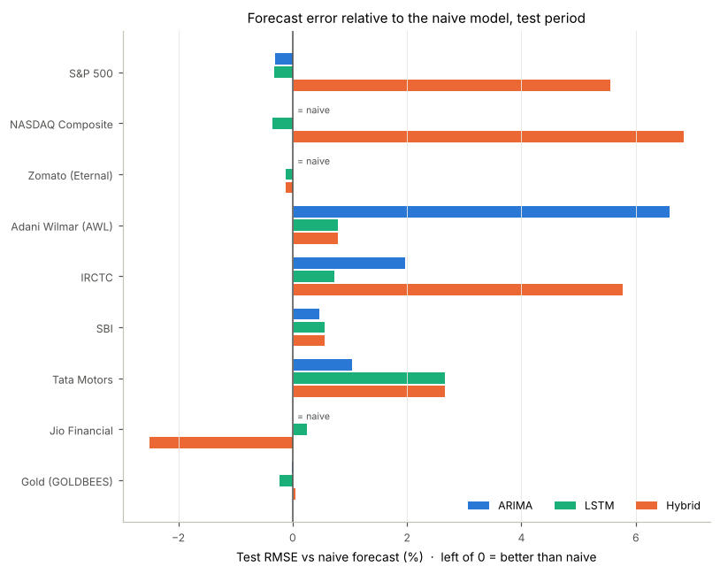
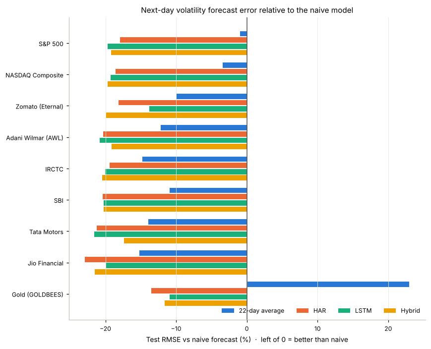
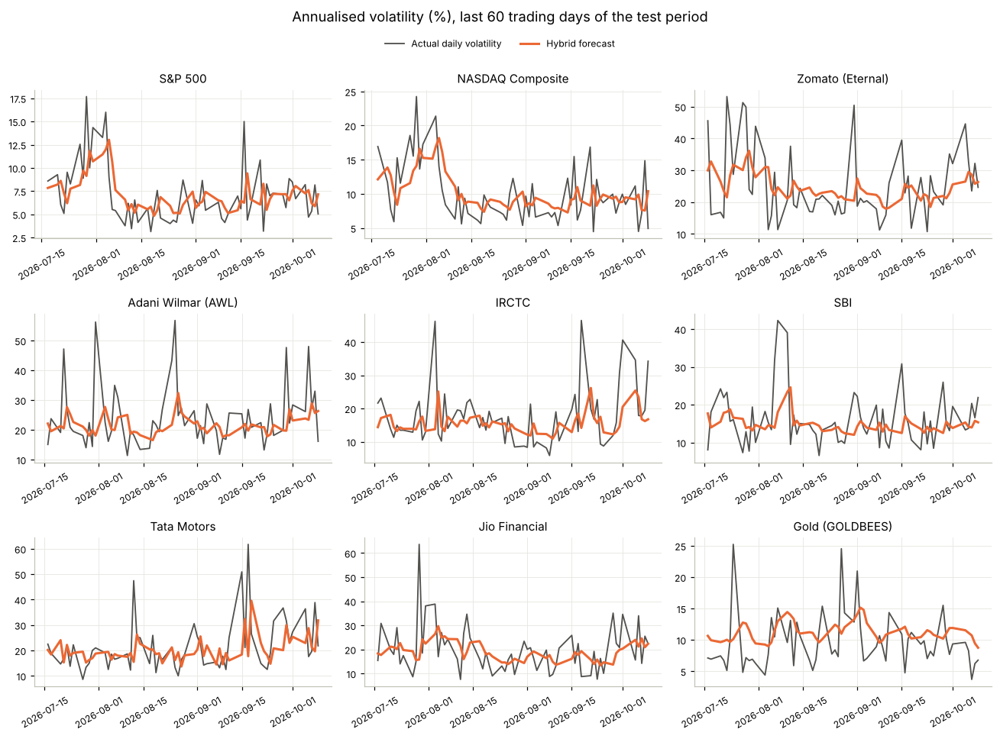

# Hybrid LSTM + ARIMA Forecasting: Prices vs Volatility

Traditional models like ARIMA (Autoregressive Integrated Moving Average) capture linear
patterns, while deep learning models like LSTM (Long Short-Term Memory) can model
non-linear relationships. This project builds a hybrid ARIMA-LSTM model that combines
the two, and tests it on nine assets against each model on its own and against simple baselines.

It has two parts with the same leak-free pipeline:

1. **Price forecasting:** the hybrid cannot beat the naive "tomorrow = today" forecast. Daily prices behave like a random walk.
2. **Volatility forecasting:** the hybrid beats the naive forecast on all nine assets, with **12–22% lower error**,
   every difference statistically significant.

## Method

1. An **LSTM** looks at the last 20 days and forecasts the next day.
2. An **ARIMA** model is fitted on the LSTM's errors (residuals) to pick up any linear
   pattern the LSTM missed.
3. **Hybrid forecast** = LSTM forecast + ARIMA's predicted error.

Data: daily prices from Yahoo Finance, last 1,500 trading days up to 9 Oct 2026, split in time order:

| Block | Share | Used for |
|---|---|---|
| Train | 70% | fitting the LSTM and the standalone models |
| Validation | 15% | fitting the ARIMA on the LSTM's out-of-sample residuals |
| Test | 15% | evaluation only |

No model sees test data while it is being fitted. Every forecast for day *t* uses only
data up to day *t-1*. This was checked by changing the last 30 days of data: every earlier forecast stayed exactly the same.

The LSTM has one layer of 32 units and is averaged over 3 random seeds. Significance is tested with the
Diebold-Mariano test.

## Assets

| Asset | Yahoo ticker | Note |
|---|---|---|
| S&P 500 | `^GSPC` | |
| NASDAQ Composite | `^IXIC` | |
| Zomato | `ETERNAL.NS` | renamed Eternal Ltd in 2025 |
| Adani Wilmar | `AWL.NS` | |
| IRCTC | `IRCTC.NS` | |
| SBI | `SBIN.NS` | |
| Tata Motors | `TMPV.NS` | prices before the 14 Oct 2025 demerger are rescaled |
| Jio Financial | `JIOFIN.NS` | listed Aug 2023, so a shorter history |
| Gold | `GOLDBEES.NS` | Nippon India gold ETF |

## Part 1: Price forecasting (`Hybrid_Model.ipynb`)

Models forecast the next day's log return, converted back to a price: `P̂(t) = P(t-1) · exp(r̂(t))`.

Test-period RMSE as a ratio of the naive forecast's RMSE (below 1.000 beats naive):

| Asset | ARIMA | LSTM | Hybrid |
|---|---|---|---|
| S&P 500 | 0.997 | 0.997 | 1.056 |
| NASDAQ Composite | 1.000 | 0.997 | 1.068 |
| Zomato | 1.000 | 0.999 | 0.999 |
| Adani Wilmar | 1.066 | 1.008 | 1.008 |
| IRCTC | 1.020 | 1.007 | 1.058 |
| SBI | 1.005 | 1.006 | 1.006 |
| Tata Motors | 1.010 | 1.027 | 1.027 |
| Jio Financial | 1.000 | 1.003 | 0.975 |
| Gold | 1.000 | 0.998 | 1.000 |
| **Average** | **1.011** | **1.004** | **1.022** |



- **No model reliably beats the naive forecast.** Every model's error is between 2.5% better
  and 6.8% worse than naive, and on average all three are slightly worse. The hybrid beats
  naive on only 2 assets (Zomato, Jio Financial), and neither difference is statistically
  significant (p = 0.64 and 0.46).
- **The hybrid does not outperform the LSTM.** On 4 of 9 assets the residual ARIMA found
  no pattern to correct, so the hybrid equals the LSTM; on Gold it only added a small constant shift.
  It has lower error on Jio Financial (not significant, p = 0.40) and significantly higher error on
  S&P 500, NASDAQ and IRCTC (p < 0.05), where the residual ARIMA fitted noise in the validation period.
- **Direction accuracy is close to a coin flip**: 48.7% ARIMA, 49.5% LSTM, 50.6% hybrid on average.
- For most assets `auto_arima` picks ARIMA(0,1,0), which is a random walk, the same as the naive forecast.

Daily price changes have almost no memory, so past prices carry little information about the next move.
Forecast lines look accurate on a chart because they mostly follow the previous day's price, one day late.

An earlier version of this project reported that the hybrid reduced price error. That result
came from fitting the ARIMA on residuals from the test period, which let the model see the
answers. The current version removes that leak.

## Part 2: Volatility forecasting (`Volatility_Hybrid.ipynb`)

**Why volatility.** The *direction* of price moves is unpredictable, but their *size* clusters:
calm days follow calm days and turbulent days follow turbulent days. For the S&P 500, the correlation
of daily returns with the previous day is -0.02, while for log volatility it is 0.57.

**Target.** Next day's **Parkinson volatility**, computed from the daily high and low:
`σ² = (ln(High/Low))² / (4 ln 2)`, annualised and modelled in logs. Errors are measured on log volatility.

Two extra baselines are added: the **22-day average** volatility, and **HAR** (a linear regression on 1-day,
5-day and 22-day volatility), the standard benchmark in volatility research.

Test-period RMSE as a ratio of the naive forecast ("tomorrow's volatility = today's"):

| Asset | 22-day avg | HAR | ARIMA | LSTM | Hybrid |
|---|---|---|---|---|---|
| S&P 500 | 0.990 | 0.820 | 0.802 | 0.803 | 0.808 |
| NASDAQ Composite | 0.966 | 0.814 | 0.799 | 0.807 | 0.803 |
| Zomato | 0.900 | 0.819 | 0.814 | 0.862 | 0.801 |
| Adani Wilmar | 0.878 | 0.797 | 0.804 | 0.792 | 0.809 |
| IRCTC | 0.852 | 0.806 | 0.809 | 0.799 | 0.796 |
| SBI | 0.891 | 0.796 | 0.801 | 0.798 | 0.797 |
| Tata Motors | 0.861 | 0.788 | 0.788 | 0.784 | 0.826 |
| Jio Financial | 0.848 | 0.771 | 0.780 | 0.800 | 0.785 |
| Gold | 1.230 | 0.865 | 0.878 | 0.891 | 0.884 |
| **Average** | **0.935** | **0.808** | **0.808** | **0.815** | **0.812** |



How the hybrid compares (Diebold-Mariano test, p < 0.05):

| Compared with | Hybrid lower error | of which significant | Hybrid higher error | of which significant |
|---|---|---|---|---|
| Naive | 9 | 9 | 0 | 0 |
| 22-day average | 9 | 5 | 0 | 0 |
| LSTM | 6 | 1 | 3 | 1 |
| HAR | 4 | 0 | 5 | 1 |

- **The hybrid beats the naive forecast on every asset**, with 12% to 22% lower error (18.8% on average),
  all statistically significant. It also beats the 22-day average on all nine assets.
- **The hybrid improves on the LSTM alone on 6 of 9 assets**, though on average only slightly.
  The clearest case is **Zomato**: the LSTM alone was the weakest model there, and the residual ARIMA found
  persistence the LSTM had missed, cutting the error by 7% (p = 0.016).
- **The hybrid works as a diagnostic.** On Adani Wilmar, IRCTC and SBI the residual ARIMA chose order (0,0,0):
  the LSTM's errors were noise, so there was nothing to correct.
- **It can overfit.** On Tata Motors the hybrid was 5% worse than the LSTM (p = 0.023). Its validation period
  includes the October 2025 demerger, and the patterns the residual ARIMA learned there did not carry over.
- **It matches, but does not beat, the classic benchmark.** HAR and ARIMA average 0.808, the hybrid 0.812;
  only one difference with HAR is significant. For a single short series, a simple linear model is as good
  as a neural network.



## What this project shows

The same modelling code fails on prices and works on volatility. The difference is the target: daily price
direction has almost no predictable structure, while volatility has a lot. Choosing a target with real signal,
testing against a naive baseline, and keeping test data out of every fitting step mattered more than the model.

## Files

| File | Contents |
|---|---|
| `Hybrid_Model.ipynb` | Part 1: price forecasting, four models, evaluation, charts |
| `Volatility_Hybrid.ipynb` | Part 2: volatility forecasting, six models, significance tests, charts |
| `LSTM_Model.ipynb` | first experiment: stacked LSTM on Apple price levels, compared with naive |
| `results.csv` | Part 1 metrics per asset and model |
| `results_volatility.csv` | Part 2 metrics per asset and model |
| `rmse_vs_naive.png`, `hybrid_last60.png` | Part 1 charts |
| `vol_vs_naive.png`, `vol_forecasts_last60.png` | Part 2 charts |

## How to run

```bash
pip install -r requirements.txt
jupyter notebook Hybrid_Model.ipynb        # or Volatility_Hybrid.ipynb
```

The data end date and random seeds are fixed. Each notebook takes a few minutes on a laptop CPU.
Yahoo Finance occasionally revises historical data, so numbers may differ slightly in later runs.

## Future work

- Walk-forward evaluation: re-fit the models as time moves on, over several test periods.
- Add inputs that drive volatility: market-wide indices (e.g. VIX), scheduled events such as earnings and central bank meetings.
- Apply the volatility model to FX pairs, where volatility forecasts feed option pricing and risk limits.
